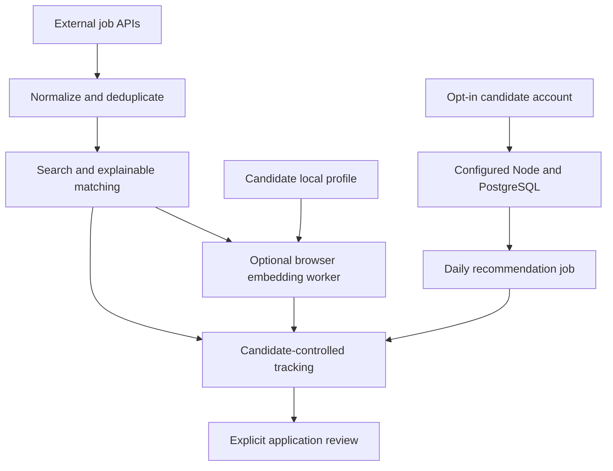

# Niko Emploi — Studio Niko Design

**Multi-source job discovery · Explainable matching · Optional local semantic inference · Candidate-controlled automation**

[](package.json) [](public/niko-neuromatch-worker.js) [](LICENSE.md)

[Application (disponibilité non vérifiée)](https://niko-emploi.vercel.app) · [Configuration](docs/CONFIGURATION_ZERO_EURO.md) · [Sécurité](SECURITY.md) · [English overview](#english-overview)

## Architecture et contrats d'exécution



| Source | Fonction |
| --- | --- |
| [lib/jobs.js](lib/jobs.js) | Connecteurs, normalisation, filtres et dédoublonnage |
| [public/niko-neuromatch-worker.js](public/niko-neuromatch-worker.js) | Transformers.js, extraction de vecteurs via MiniLM quantifié |
| [lib/niko-runner.js](lib/niko-runner.js) | Veille serveur pour candidats opt-in, sous configuration |
| [lib/niko-db.js](lib/niko-db.js) | Connexion PostgreSQL/Neon |
| [vercel.json](vercel.json) | Déclaration de la tâche planifiée |

Le code contient un véritable appel de pipeline `feature-extraction` dans le Worker, distinct du score explicable classique. Ce n'est pas une preuve de chargement effectif du modèle sur chaque appareil. Les sources intégrées peuvent être indisponibles ; leur couverture et leurs conditions d'accès ne sont pas revérifiées ici.

**Version technique :** le manifeste npm exige Node.js 24.x. Le moteur autonome serveur dépend de la configuration réelle de la base, du chiffrement et des services concernés ; la déclaration Cron ne prouve pas son exécution.

## Mode 0 € sans aucune clé

Le radar, la recherche, le suivi des entreprises, les lettres locales, les rappels au format calendrier et l'analyse manuelle de réponses recruteurs restent disponibles gratuitement. L'application ne fabrique aucune preuve d'embauche. Les boutons d'envoi Gmail direct restent désactivés tant que Google OAuth n'est pas configuré. Le cloud candidat exige un fournisseur de base de données et un expéditeur autorisés ; **aucun abonnement ni frais n'est engagé automatiquement**.

[Guide complet de configuration 0 €](docs/CONFIGURATION_ZERO_EURO.md).

## Radar marché caché — entreprises et suivi local

Dans `/marche-cache.html`, le Radar recense des entreprises par SIREN et propose un **suivi personnel de prospection** : états, notes, dates de relance et export CSV/JSON. Les données restent sur l'appareil et ne sont pas chiffrées localement. Aucun message n'est envoyé automatiquement.

Le service **La Bonne Boîte** est accessible par lien officiel pour consulter manuellement le potentiel d'embauche. L'accès API v2 n'est **pas activé** sans habilitation ; voir [le guide de préparation de l'intégration](docs/RADAR_LBB_INTEGRATION.md). Aucune probabilité d'embauche n'est déduite des données de l'Annuaire des entreprises.


**Une seule application autonome, sans Supabase et sans n8n.** La logique des agents est intégrée à ce dépôt Node/Vercel ; PostgreSQL/Neon assure uniquement le stockage persistant.

- Radar de recherche et rapprochement des offres par cinq axes explicables, accessible sans compte dans le navigateur.
- Comptes candidats natifs par lien e-mail à usage unique, sessions HTTP-only, CV/lettres chiffrés (lorsque Neon, Resend et les variables serveur sont configurés).
- Agent personnel opt-in, seuil de score, filtres télétravail et inclusion, bouton arrêter, historique des recommandations et aperçu immédiat.
- Vercel Cron quotidien : indexation des sources d'offres autorisées et veille personnalisée des candidats opt-in, même lorsque leur navigateur est fermé.
- L'agent ne peut pas envoyer de candidatures ou répondre à un recruteur tout seul : les envois restent soumises aux autorisations et contrôles explicites du candidat. Les réponses Gmail de la version navigateur ne sont pas surveillées par le serveur.

**Mise en service :** lire [docs/MISE_EN_SERVICE_V2.md](docs/MISE_EN_SERVICE_V2.md). Les migrations sont [database/niko-autonomy.sql](database/niko-autonomy.sql) puis [database/niko-engine-v4.sql](database/niko-engine-v4.sql). Sans DATABASE_URL, chiffrement, domaine expéditeur et authentification correctement configurés, les fonctions d'autonomie côté serveur restent volontairement inactives.

## Niko Intelligence 5.0 — IA réellement gratuite dans le navigateur

**Nouveau dans le Studio :** un module NeuroMatch facultatif, exécuté sur l'appareil du candidat, pour explorer les offres avec un modèle de langue multilingue, plus un **passeport de compétences** et des **pistes de métiers voisins**. Les modèles gratuits sont téléchargés uniquement sur action du candidat ; les préférences « utile/écarté » restent stockées localement et peuvent être effacées.

Le passeport fonctionne immédiatement sans téléchargement d'IA. Le classement sémantique utilise Transformers.js et le modèle quantifié **paraphrase-multilingual-MiniLM-L12-v2** (~118 Mo de poids, autres ressources supplémentaires) ; il ne dépend d'aucune clé IA payante. L'application conserve le radar classique lorsque l'IA locale échoue. Aucun appel à un serveur d'inférence n'est effectué pour analyser le CV.

**Limite honnête :** les tests unitaires passent, mais le chargement réel du modèle doit encore être vérifié sur navigateurs et appareils représentatifs. L'IA locale n'active pas les agents serveur sans base de données.

[Guide complet de l'IA locale gratuite](docs/IA_LOCALE_GRATUITE.md).

## Sources d'emplois étendues (API)

Le moteur interroge maintenant **EasyJobs, Jobicy, Arbeitnow et Himalayas**, avec attribution visible, validation des liens, contrôle des annonces expirées, filtrage de l'éligibilité France et dédoublonnage. L'API publique Himalayas fonctionne sans clé ; une clé serveur facultative augmente ses quotas.

Deux connecteurs supplémentaires sont prêts à être activés depuis les **variables Vercel**, sans modifier le code :

- **Adzuna France** : `ADZUNA_APP_ID` et `ADZUNA_APP_KEY`.
- **Greenhouse Job Board** : `GREENHOUSE_BOARDS=jeton-du-tableau:Entreprise réelle` (plusieurs entreprises séparées par `;`, quatre maximum).

Ces deux sources **ne sont pas activées sans la configuration correspondante**. Les règles des fournisseurs, leurs limites, la provenance et les exemples de configuration figurent dans [docs/SOURCES_API.md](docs/SOURCES_API.md). Aucun nombre de postes additionnels n'est garanti avant une interrogation réussie des API.

Tests : `npm test`. Site : https://niko-emploi.vercel.app

---

## Historique — édition 1.0

Moteur d'offres d'emploi **réelles** (jamais de faux résultats de démonstration) avec recherche, filtres, favoris et dédoublonnage intersources.

## Studio candidature — édition 1.1

La page \`/candidatures.html\` fournit un parcours complet :
- Import **PDF / DOCX / TXT** (maximum 8 Mo), extraction locale du texte, correction et suppression du profil. Les CV scannés sans couche texte nécessitent une version OCR.
- Moteur d'offres réel existant, score ATS indicatif, compétences communes/manquantes, regroupement d'offres inclusives portant des **mentions explicites** RQTH / handicap / aménagement. Une offre sans mention peut néanmoins être accessible. Agefiph et Handimatch sont proposés comme ressources externes, sans scraping.
- Lettre locale personnalisée, et rédaction IA optionnelle par l'API Responses uniquement avec consentement. Aucune expérience n'est inventée ; le candidat relit et modifie la lettre. Le statut RQTH n'est jamais ajouté automatiquement.
- Candidature **Gmail** par OAuth Google Identity Services : pièce jointe CV, e-mail au recruteur, historique et envoi groupé limité à 5 offres par lot après vérification et consentement.
- **Agent de réponse recruteur** : classement local des réponses favorables/défavorables, invitations à un entretien et cas ambigus, génération de brouillons, option d'analyse IA consentie, et réponses Gmail dans le fil existant. Les réponses complexes exigent validation. Un réglage opt-in autorise uniquement les **accusés de réception fixes** pour les réponses clairement favorables ou défavorables. Ce mode surveille les fils uniquement **tant que la page reste ouverte**.

### Préparer les intégrations sur Vercel

Variables d'environnement :
\`\`\`text
OPENAI_API_KEY=...                 # optionnel, secret serveur, ne jamais exposer au navigateur
OPENAI_MODEL=gpt-4.1-mini          # optionnel
GOOGLE_CLIENT_ID=...apps.googleusercontent.com
\`\`\`

Créer un client OAuth 2.0 de type **application Web** dans Google Cloud, activer **Gmail API**, ajouter l'origine JavaScript \`https://niko-emploi.vercel.app\`, configurer écran de consentement et autoriser les scopes \`gmail.send\` et \`gmail.readonly\`. L'accès Gmail nécessite **la vérification Google** des scopes sensibles/restrictifs pour une diffusion publique, et peut être limité en mode test. Le \`GOOGLE_CLIENT_ID\` est public ; **ne mettez jamais de secret Google ou OpenAI dans \`public/\`**.

L'application garde les jetons Google OAuth **en mémoire du navigateur** : pas de persistance de connexion et donc **aucun monitoring 24/7 ni envoi quand la page est fermée**. Pour une automatisation permanente il faut concevoir un backend OAuth à refresh tokens chiffrés, une base de données isolée par utilisateur, un ordonnanceur, un historique d'approbation, des contrôles de limitation/désinscription et une revue RGPD/sécurité. Ce backend n'est **pas** encore livré.

Les candidats renseignent eux-mêmes l'adresse e-mail du recruteur si l'API de l'offre n'en fournit pas. Les sites ATS externes ne sont pas soumis automatiquement : utiliser le lien de l'annonce sans contourner CAPTCHA ni conditions d'utilisation.

Le navigateur conserve le profil uniquement si l'utilisateur le choisit, et sauvegarde localement son historique (effaçable). Les appels IA traitent temporairement les données textuelles consenties. Avant une ouverture publique, finaliser les mentions légales, la politique de confidentialité, les coordonnées du responsable de traitement et la vérification OAuth. Ne jamais transmettre de RQTH sans consentement spécifique.

Tests : \`npm test\` (moteur de recherche, CV/ATS, protection RQTH, serveur/API), vérification de syntaxe automatisée sur GitHub Actions.

## Utiliser localement

Node.js 24.x (version déclarée dans package.json) :

```sh
npm install
npm start
```

Ouvrir **http://localhost:3000**. Le navigateur communique avec `GET /api/jobs`, qui interroge les plateformes publiques. **Internet est indispensable pour que des offres apparaissent**. Si les fournisseurs ne répondent pas, 0 offre est affichée avec un message d'erreur.

Tests automatiques :

```sh
npm test
```

## Déployer

Ce projet fonctionne également sur Vercel : `public/` est le site statique et `api/jobs.js` une fonction Node.js. Déployer le dossier racine, sans configuration de clé d'API. Le moteur ne scrape pas France Travail.

## Sources intégrées

- **EasyJobs** (France) : `https://api.easyjobs.fr/public/v1/jobs/search`, accès anonyme, pagination de 50 résultats, 2 pages maximum. Afficher `job_url` de la réponse (attribution conservée). Documentation : https://api.easyjobs.fr/public/docs/
- **Jobicy** (emploi à distance accessible en Europe) : `https://jobicy.com/api/jobs?count=200&geo=europe` et `...&geo=france`, puis exclusion des offres réservées à un autre pays. Annonces des 7 derniers jours selon leur API, crédit obligatoire et clic vers la fiche Jobicy. Documentation : https://jobicy.com/jobs-rss-feed
- **Arbeitnow** : `https://www.arbeitnow.com/api/job-board-api`, conservées uniquement les annonces France ou télétravail explicitement éligibles à une zone internationale. Source et lien visibles. Conditions : https://www.arbeitnow.com/terms/

**France Travail :** l'API officielle Offres d'emploi est annoncée comme restreinte/suspendue à la réutilisation publique au 22/10/2026 : https://www.data.gouv.fr/dataservices/api-offres-demploi . Demander son habilitation, ne pas contourner ses restrictions.

## Anti-doublons & honnêteté statistique

- Vérification des données minimales (intitulé, employeur, lieu, URL HTTP/HTTPS, provenance).
- Détection des URLs équivalentes sans paramètres de tracking ; rapprochement employeur + poste + lieu avec normalisation accents/ponctuation.
- Les offres multi-villes réellement distinctes sont conservées.
- Les fournisseurs inaccessibles sont signalés ; aucun emploi fictif n'est injecté.
- **Le nombre annoncé est celui des résultats effectivement récupérés et filtrés, et non le total national.** L'objectif « 10x plus que France Travail » n'est pas considéré comme atteint sans mesures validées à périmètre équivalent.
- Certaines variantes de titres ou annonces rediffusées peuvent échapper à la détection : un taux anti-doublon de 100 % ne peut pas être garanti sans identifiant de poste commun entre fournisseurs.
- L'affichage d'une offre ne certifie pas que le recrutement reste ouvert au moment du clic : utiliser le lien source.

## Évolutions pour production

Pour le passage à grande échelle, ajouter une base PostgreSQL avec identifiants persistants et URLs canoniques, crawler uniquement les sources autorisées, contrôle des statuts actifs, rapprochement probabiliste supervisé, horodatage, signalement de doublons, journal des consentements/licences, tâches de synchronisation et surveillance des limites fournisseurs. Ajouter la source France Travail uniquement après autorisation.

## Confidentialité

Le moteur d'offres n'enregistre pas les données candidats. Le Studio candidature traite le CV dans le navigateur et le conserve localement sur choix explicite ; les lettres générées par IA font appel à l'API externe seulement avec consentement. Les candidatures Gmail passent par l'API Google avec autorisation OAuth. L'historique local peut être effacé.

Projet indépendant : pas d'affiliation institutionnelle à France Travail.

## Application PWA installable (Android, iOS, ordinateur)

Site public : https://niko-emploi.vercel.app. Le manifeste \`/manifest.webmanifest\`,
les icônes PNG (192, 512 et Apple 180 px), le service worker \`/sw.js\`
et un bouton « Installer Niko Emploi » sont intégrés au moteur d'offres et au Studio.

- **Android** (Chrome / Samsung Internet) : « Installer Niko Emploi » puis confirmer, ou menu du navigateur > Installer l'application.
- **iPhone / iPad** : menu Partager > Ajouter à l'écran d'accueil > Ajouter.
- **Ordinateur** (Chrome / Edge) : « Installer Niko Emploi » ou menu du navigateur ; macOS Safari : Fichier > Ajouter au Dock.
- **Hors connexion** : seule l'interface publique de base et la page d'explication restent disponibles. Les offres, CV, jetons, données de compte, réponses d'agents et candidatures ne sont **jamais** stockés dans le cache PWA. Aucun résultat n'est inventé.
- Le navigateur actualise le service worker sur déploiement; pour publier une nouvelle version du shell, incrémenter \`CACHE_NAME\` dans \`public/sw.js\`.

Tests : \`npm test\` inclut les contrôles structurels PWA.


## Qualification proposée

Avec profils et annonces fictifs ou réponses de fournisseurs simulées, vérifier le dédoublonnage, les liens sources, les erreurs, le classement explicable et le repli quand le modèle local est indisponible. Tester séparément l'activation et la révocation du consentement candidat, les autorisations de compte, les exports et le désabonnement. Ne pas envoyer de candidature réelle ni transmettre de CV ou de données sensibles pour ces essais.

Le moteur de rapprochement n'établit ni une probabilité d'embauche ni une évaluation objective des candidats. Les préférences locales et les données de CV nécessitent une protection adaptée. Les fonctions Gmail de premier plan sont distinctes de la veille serveur opt-in. Aucun nouvel essai, appel fournisseur, contrôle de configuration de production ou benchmark n'a été réalisé ici.

## English overview

Niko Emploi combines multi-source job discovery, normalization and deduplication, explainable matching, optional local multilingual MiniLM embeddings, candidate tracking and conditional server-side recommendations. The browser model is downloaded on request; its successful inference has not been verified in this documentation revision. Server autonomy requires configured PostgreSQL and security settings, with candidate opt-in. Job listing availability and hiring outcomes are not guaranteed. Applications and recruiter replies must respect the documented consent controls. Run with Node.js 24.x, install dependencies using npm install, then npm start. See the configuration and security guides for deployment conditions.

## Licence et contribution

[LICENSE.md](LICENSE.md) : droits réservés pour les contributions originales concernées. Les sources d'emploi, modèles et bibliothèques tiers restent soumis à leurs conditions et licences. Ne jamais partager de CV, de jeton ou de données candidat dans une issue publique.

**Studio Niko Design** · Candidate control, provenance and explainable matching.
